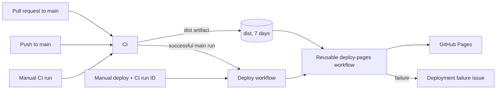

# GitHub Actions workflows

This document describes the repository automation under [`.github/workflows/`](../.github/workflows/). The YAML files are the source of truth; this document records each workflow's purpose, trust boundaries, inputs and operational behavior.

## At a glance

| Workflow                                                              | Trigger                              | Purpose                                                          | Result                                                                    |
| --------------------------------------------------------------------- | ------------------------------------ | ---------------------------------------------------------------- | ------------------------------------------------------------------------- |
| [`ci.yml`](../.github/workflows/ci.yml)                               | PR to `main`, push to `main`, manual | Validate and build the application                               | A `dist` artifact retained for 7 days                                     |
| [`deploy.yml`](../.github/workflows/deploy.yml)                       | Successful CI on `main`, manual      | Select the CI artifact to deploy and report a deployment failure | Calls the reusable Pages deployment workflow; creates an issue on failure |
| [`deploy-pages.yml`](../.github/workflows/deploy-pages.yml)           | `workflow_call` only                 | Publish a supplied `dist` artifact to GitHub Pages               | GitHub Pages deployment and `page_url` output                             |
| [`codeql.yml`](../.github/workflows/codeql.yml)                       | PR to `main`, weekly schedule        | Scan JavaScript/TypeScript for code-security issues              | Code scanning results in GitHub Security                                  |
| [`dependency-review.yml`](../.github/workflows/dependency-review.yml) | PR to `main`                         | Review dependency changes for known vulnerabilities              | PR summary; fails on high/critical findings                               |

## Delivery flow



The automatic deploy path only continues when the triggering CI run completed successfully. A manually dispatched deploy instead receives the CI run ID from the operator.

## Common conventions

- Workflow and job names are human-readable so they are identifiable in the Actions UI.
- Workflows declare permissions explicitly. A job can further reduce them when it needs less access.
- Job summaries use `$GITHUB_STEP_SUMMARY`; step-to-job data uses `$GITHUB_OUTPUT`.
- `dist` is built once by CI and then downloaded by the deployment workflow. Deployments do not rebuild the application.
- Workflow files use official actions pinned to major versions. Updating an action major version should be reviewed like any other supply-chain change.

## CI — `ci.yml`

### Trigger and permissions

CI runs on pushes to `main`, pull requests targeting `main`, and `workflow_dispatch`. It has only:

```yaml
permissions:
  contents: read
```

This is sufficient to check out the source and execute validation. CI does not publish packages, deploy, or write to the repository.

### Concurrency

```yaml
concurrency:
  group: ${{ github.workflow }}-${{ github.head_ref || github.run_id }}
  cancel-in-progress: true
```

For a pull request, `github.head_ref` is its source branch, so a newer push to the same PR cancels its obsolete CI run. For a push or manual run, `head_ref` is empty and the unique `run_id` is used; those runs do not share a group with one another.

### Jobs and artifact contract

| Job                | Depends on                         | Purpose                                                                                                             |
| ------------------ | ---------------------------------- | ------------------------------------------------------------------------------------------------------------------- |
| `context`          | —                                  | Writes selected GitHub context values to the job summary. It also demonstrates `contains()` for code-change events. |
| `lint`             | —                                  | Runs Prettier verification and ESLint on Node 22.                                                                   |
| `test`             | —                                  | Runs Vitest on Node 20 and Node 22. The matrix does not fail fast, so both results are retained.                    |
| `validate-sprites` | —                                  | Runs `npm run validate:sprites`, writes a sprite table even after a validation failure, and exposes `sprite-count`. |
| `build`            | `lint`, `test`, `validate-sprites` | Builds the app, then uploads the `dist` artifact.                                                                   |

`validate-sprites` writes its count to `$GITHUB_OUTPUT`:

```yaml
outputs:
  sprite-count: ${{ steps.count.outputs.sprites }}
```

`build` reads it through `needs.validate-sprites.outputs.sprite-count`. This is a job-output example, not a deployment input.

The final artifact is named `dist`, contains `dist/`, is retained for seven days, and treats a missing directory as an error. This artifact name is the contract consumed by `deploy-pages.yml`.

### Useful diagnostics

The `context` job summary includes `event_name`, refs, SHA, actor, `run_id`, and `run_attempt`. For a manual deployment, use the `run_id` of a successful CI run as the deploy workflow input.

The sprite summary uses `if: ${{ always() }}` so that invalid sprites still produce a table useful for diagnosis. Uploading the build artifact uses an explicit `success()` condition; it makes the otherwise default behavior visible in the YAML.

## Deploy orchestrator — `deploy.yml`

This workflow decides whether a Pages deployment may begin. It does not run deployment steps directly.

### Trigger behavior

| Event                             | Deploy behavior                                                 |
| --------------------------------- | --------------------------------------------------------------- |
| `workflow_run` for `CI` on `main` | Deploys only when the CI conclusion is `success`.               |
| `workflow_dispatch`               | Deploys the artifact identified by the required `run_id` input. |

The manual `run_id` is currently an operator-supplied value. It must identify a CI run that uploaded the `dist` artifact. Semantic validation that it is specifically a successful `main` CI run is intentionally deferred to the backlog.

### Permissions and concurrency

At workflow level, deployment has `actions: read`, `contents: read`, `pages: write`, and `id-token: write`. The reusable workflow cannot elevate these permissions; it receives at most the permissions granted by this caller.

All deployments share this concurrency group:

```yaml
concurrency:
  group: pages
  cancel-in-progress: false
```

A later deployment waits rather than interrupting one already publishing. This is deliberately different from CI, where cancelling an obsolete PR validation is desirable.

### Called workflow and failure notification

The `deploy` job calls:

```yaml
uses: ./.github/workflows/deploy-pages.yml
```

and passes the selected artifact run ID and the `github-pages` Environment name. A reusable-workflow call is a job, not a step: it cannot also contain `runs-on` or `steps` in the caller.

If that job fails, `notify-deploy-failure` runs with only `issues: write`. It creates an issue with links to the failed deployment run and, for automatic runs, the CI run that triggered it. It does not create an issue when deployment was skipped because CI failed.

## Reusable Pages publisher — `deploy-pages.yml`

This workflow is invoked only by another workflow through `workflow_call`.

### Inputs and output

| Name               | Direction      | Meaning                                               |
| ------------------ | -------------- | ----------------------------------------------------- |
| `artifact_run_id`  | Required input | CI run ID from which to download the `dist` artifact. |
| `environment_name` | Required input | GitHub Environment that governs the deployment.       |
| `page_url`         | Output         | URL returned by `actions/deploy-pages`.               |

The output is propagated in three layers:

```text
steps.deployment.outputs.page_url
  → jobs.deploy.outputs.page_url
  → on.workflow_call.outputs.page_url
  → needs.<calling-job>.outputs.page_url
```

For example, a job in the caller that has `needs: deploy` can read:

```yaml
${{ needs.deploy.outputs.page_url }}
```

### Deployment steps and Environment

The reusable job downloads artifact `dist` from `artifact_run_id`, configures Pages, uploads the artifact, and invokes `actions/deploy-pages`.

It assigns the job to the supplied Environment and publishes the URL there:

```yaml
environment:
  name: ${{ inputs.environment_name }}
  url: ${{ steps.deployment.outputs.page_url }}
```

The `github-pages` Environment is where required-reviewer protection is configured in the GitHub UI. A future rollback or staging workflow can reuse this publisher with a different artifact run ID or Environment.

## CodeQL — `codeql.yml`

CodeQL scans JavaScript and TypeScript:

```yaml
languages: javascript-typescript
```

It runs on pull requests targeting `main` and every Monday at 04:23 UTC. Scheduled workflow runs analyze the default branch, allowing updated CodeQL queries to find issues in unchanged code.

> It does **not** currently run on direct pushes to `main`. Pull-request checks and the scheduled scan are the configured coverage.

The workflow needs `contents: read` to inspect source code and `security-events: write` to upload SARIF results to GitHub Code Scanning. It does not have `pull-requests: write` and does not post a conversational PR comment; findings appear in checks and in **Security → Code scanning**.

## Dependency review — `dependency-review.yml`

Dependency review runs for pull requests targeting `main`. It uses `actions/dependency-review-action` to compare dependency changes and fails when a newly introduced vulnerability has severity `high` or `critical`:

```yaml
fail-on-severity: high
```

It has `contents: read` to inspect the change and `pull-requests: write` because `comment-summary-in-pr: always` publishes the dependency-review summary on the pull request. Removing the comment would allow this permission to be reduced to read-only access.

## Repository security settings

Secret scanning and push protection are repository settings, not workflow YAML. Confirm their state in **Settings → Security → Advanced Security**.

| Control           | What it protects                                                                                      |
| ----------------- | ----------------------------------------------------------------------------------------------------- |
| Secret scanning   | Detects recognized credentials already present in repository content.                                 |
| Push protection   | Blocks a push containing a detected secret unless the contributor resolves or explicitly bypasses it. |
| CodeQL            | Finds supported code-security patterns in JavaScript/TypeScript.                                      |
| Dependency review | Reviews dependencies introduced or changed by a pull request.                                         |

These controls are deterministic guardrails. An agent can later explain a finding or propose a remediation, but it should not be the authority that bypasses a security gate.

## Operating the workflows

### Find an artifact run ID

1. Open **Actions → CI** and select a successful run.
2. Open the `Run context` job summary, or copy the numeric ID from the run URL.
3. Use that number as `run_id` when manually dispatching **Deploy to GitHub Pages**.

### Approve a protected deployment

If the `github-pages` Environment requires approval, the deployment job waits in Actions until an authorized reviewer approves it under the Environment protection rules.

### Investigate a failed deployment

1. Open the failed **Deploy to GitHub Pages** run and inspect the called workflow job.
2. Open the issue created by `notify-deploy-failure`; it links back to the failed run.
3. Check whether the CI artifact still exists. CI retains it for seven days.
4. After correcting the cause, deploy a successful CI artifact again.

## Changing a workflow

When changing workflow automation:

1. Keep permissions at the smallest scope required by the specific workflow or job.
2. Review trigger changes carefully, especially `workflow_run`, schedules, and manual inputs.
3. Preserve the `dist` artifact contract unless both CI and the reusable deploy workflow are updated together.
4. Consider concurrent runs and whether work should be cancelled or allowed to finish.
5. Test through a pull request where possible and inspect both checks and job summaries.
